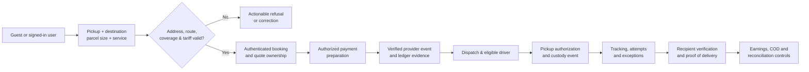
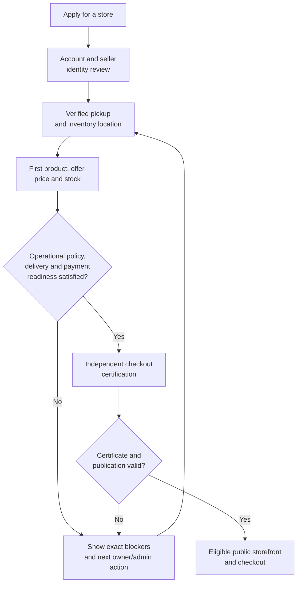
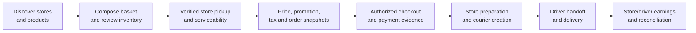
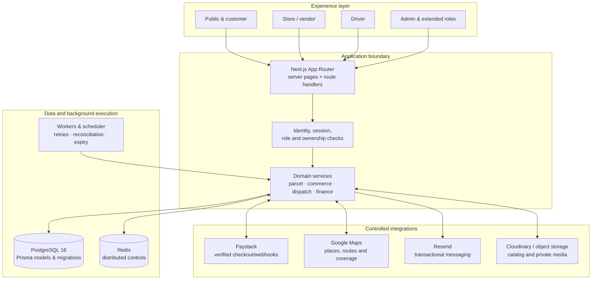
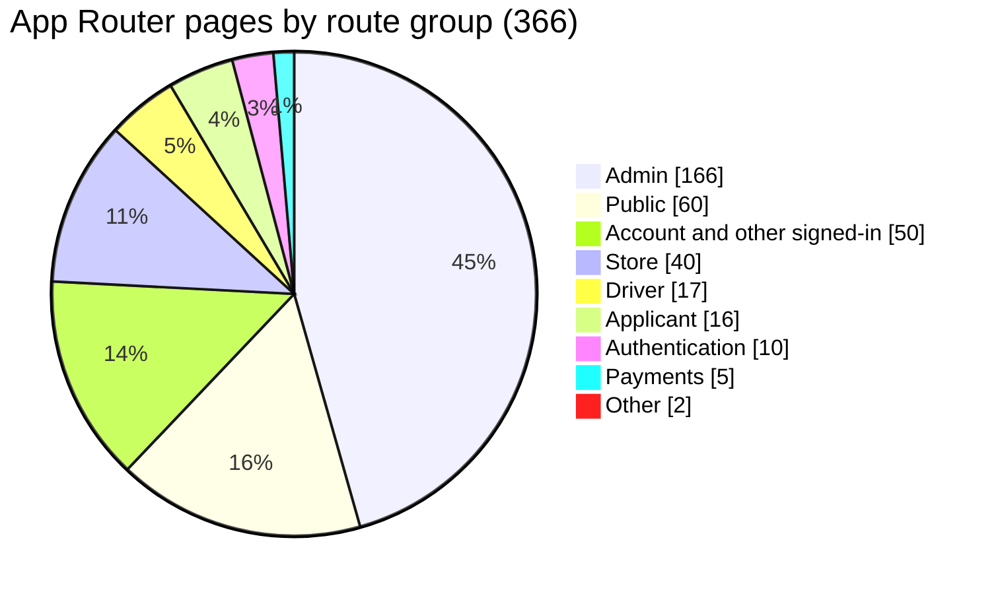
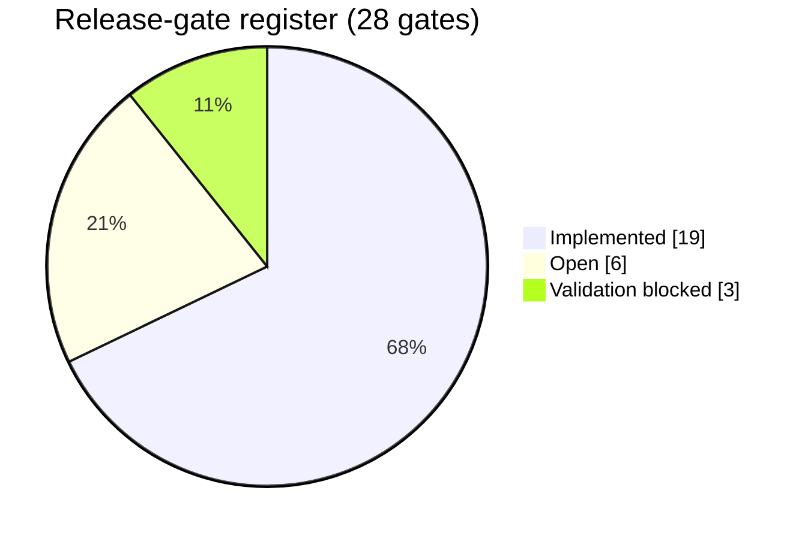

<div align="center">

  

  <h1>KT COURIERS</h1>

  <p><strong>The operating platform for commerce, couriers &amp; the last mile.</strong></p>

  <p>A South African, multi-role marketplace and logistics system connecting customers, independent stores, drivers and platform operators — from product discovery or parcel quotation to verified handover and financial reconciliation.</p>

  <p><a href="#the-platform"><strong>Explore the platform</strong></a> · <a href="#system-architecture"><strong>Architecture</strong></a> · <a href="#quick-start"><strong>Run locally</strong></a> · <a href="#engineering-intelligence"><strong>Engineering evidence</strong></a> · <a href="#release-readiness"><strong>Release position</strong></a></p>

  <p>
    <a href="https://github.com/analyticsmath/KT-Courier/actions/workflows/ci.yml"></a>
    <a href="https://github.com/analyticsmath/KT-Courier/actions/workflows/production-certification.yml"></a>
    
    
    
  </p>

  <p><a href="https://valtumstudio.com.au/"></a></p>
  <p><sub>SOFTWARE PLATFORM OWNERSHIP &amp; ENGINEERING &nbsp;·&nbsp; <a href="https://valtumstudio.com.au/">VALTUM STUDIO</a> &nbsp;·&nbsp; AUSTRALIA</sub></p>

</div>

---

> [!IMPORTANT]
> **Engineering implementation is not commercial launch authorization.** The checked-in [release-gate register](./docs/production-closure/engineering-gates.json) classifies the platform as **`NOT_READY`**: **19 implemented**, **6 open**, and **3 validation-blocked** gates. A successful CI build or healthy deployment does not certify real payments, physical deliveries, finance controls, or operator sign-off. This README documents the code and its boundaries; it does not override those gates.

## The platform

KT Couriers brings two distinct journeys into one operating ecosystem:

| **Parcel logistics** | **Marketplace commerce** |
| :--- | :--- |
| A customer or store obtains a quotation, books a point-to-point delivery, pays through an authorized checkout flow, and follows dispatch, collection, transit and proof of delivery. | A customer discovers independent sellers, builds a basket, reviews serviceable delivery options and checks out against store, stock, payment and fulfilment controls. |
| **Core handoff:** quote → booking → payment → dispatch → pickup → delivery. | **Core handoff:** seller verification → catalog → checkout → store fulfilment → courier handoff → customer. |
| [Parcel journey specification](./docs/production-closure/PARCEL_FULL_PERSONA_LIFECYCLE_REVIEW_2026-11-12.md) | [Marketplace checkout architecture](./docs/checkout/marketplace-orders.md) |

**One customer identity.** Parcel and shopping experiences share a customer access model rather than requiring separate customer registrations. **Different commercial authorities.** Direct parcel orders and marketplace store orders retain distinct business rules, fulfilment evidence and financial controls.

### Experiences by role

| Workspace | Principal capabilities in the codebase | Entry point |
| :--- | :--- | :--- |
| **Customer** | Guest parcel quoting, signed-in booking, shopping, order history, addresses, tracking, wallet and support | `/quote` · `/shop` · `/account` |
| **Store / vendor** | Guided onboarding, seller identity, pickup location, catalog and offers, inventory, store orders and outbound parcel booking | `/store/get-started` · `/store/catalog` |
| **Driver** | Onboarding and document review, availability, offers and assignments, GPS updates, pickup/delivery evidence, cash custody and earnings | `/driver` · `/driver/assignments` |
| **Operations / admin** | Store and driver review, coverage and pricing policy, dispatch, exceptions, payments, reconciliation, notifications and audit surfaces | `/admin` · `/admin/dispatch` |
| **Extended surfaces** | Promoter programme, developer integrations, reporting and applicant workflows | `/promoter` · `/developers` · `/reports` |

> **Coverage is an operational decision, not a marketing promise.** Nationwide storefront discovery and route-specific delivery eligibility are separate concerns. Delivery only proceeds when the configured coverage, selected service, pickup/destination evidence and applicable operating policy permit it. Service expansion must not be inferred from the presence of a public page.

## How the journeys fit together

### 01 / Direct parcel: from quote to custody closure



The source implements identity, ownership, payment, assignment and custody boundaries at different stages. A quotation is **not** itself a paid booking; a payment redirect is **not** evidence of settlement; and a driver status change is **not** independently sufficient proof of delivery.

[Read the persona-by-persona lifecycle review](./docs/production-closure/PARCEL_FULL_PERSONA_LIFECYCLE_REVIEW_2026-11-12.md) · [Real-account acceptance matrix](./docs/production-closure/PARCEL_REAL_ACCOUNT_ACCEPTANCE_MATRIX_2026-11-12.md)

### 02 / Vendor: make opening a shop understandable

The store workspace is designed around **progressive, owner-actionable onboarding**, with account approval deliberately separated from public checkout readiness.



The current onboarding projection distinguishes **account application**, **account approved**, **getting shop ready**, **shop live** and **shop paused**. Its cockpit groups identity, pickup/inventory, first product and commercial certification into understandable stages. Publication and checkout must still respect independently reviewed seller, address, inventory and policy evidence.

**Source:** [store onboarding service](./lib/services/store-onboarding.service.ts) · [store onboarding UI](./components/store/StoreOnboardingCockpit.tsx) · [checkout certification](./lib/admin/store-checkout-certification.service.ts)

### 03 / Marketplace: commerce is not just a cart



The checkout path protects against stale inventory, invalid collection addresses, unsupported delivery routes and mismatched commercial snapshots. Store approval, product visibility and the ability to accept a payable order are intentionally different states.

## System architecture

The repository is a **Next.js 16 App Router** application with domain-oriented services, PostgreSQL persistence via Prisma, Redis-backed shared infrastructure, and dedicated operations/processor entry points.



**Architectural principles**

- **Server-side authority:** clients can initiate actions, but server-side ownership, permission, state, coverage and financial checks determine what commits.
- **Explicit lifecycle transitions:** orders, assignments, refunds, earnings, seller publication and operational policies are modelled with guarded state changes and audit evidence.
- **Financial integrity:** amounts are handled in ZAR with controlled decimal/minor-unit boundaries; payment confirmation, idempotency, journals and reconciliation are distinct concerns.
- **Fail-closed integrations:** unavailable providers, incomplete pickup evidence, unapproved configurations and unknown payment results must not silently become successful transactions.
- **Separate web and operations processes:** the HTTP application, background worker and scheduler have different responsibilities; running a page server alone does not prove processing health.

[Architecture source](./lib/) · [Database schema](./prisma/schema.prisma) · [OpenAPI description](./openapi/kt-couriers-v1.json) · [Deployment topology and dependencies](./docs/production-closure/ENVIRONMENT_AND_ACTIVATION_DEPENDENCIES.md)

### Technology inventory

| Layer | Current repository technology |
| :--- | :--- |
| Frontend & HTTP | Next.js **16.4.2**, React **19.2.4**, App Router, TypeScript, Tailwind CSS 4 |
| Persistence | PostgreSQL 16, Prisma 5, versioned SQL migrations |
| Shared services | Redis 7, `ioredis`, background worker and scheduler scripts |
| Testing | Vitest 4, Playwright / Chromium, disposable PostgreSQL and Docker-based integration tests |
| Digital payment | Paystack as the active designed checkout rail; PayFast retained for legacy reconciliation/refund compatibility |
| Maps and messaging | Google Maps APIs, Resend email |
| Media & deployment | Cloudinary and private/object-storage adapters; Docker, Vercel/Railway deployment configuration |

*An integration's presence in source or environment templates does not certify that its production credentials, scopes, accounts or operator approvals are active.*

## Engineering intelligence

A repository-wide **file census** was taken against `main` at source commit [`8f990a2`](https://github.com/analyticsmath/KT-Courier/commit/8f990a259efbe224ee6ddef907836356f70ed0b7) on **16 November 2026**. These are inventory counts, **not** coverage percentages, live business KPIs or statements that all files were manually reviewed line by line.

| Application footprint | Count | Definition |
| :--- | ---: | :--- |
| App Router pages | **366** | Tracked `app/**/page.tsx` entry points |
| HTTP route handlers | **789** | Tracked `app/api/**/route.ts` files |
| Test files | **1,481** | Tracked `*.test.*` and `*.spec.*` source files |
| Prisma models | **453** | `model` declarations in `prisma/schema.prisma` |
| Engineering Markdown documents | **638** | `.md`/`.mdx` files under `docs/` |

### Application surface distribution



*Method: count the first App Router route-group directory for every tracked `page.tsx`. This chart describes where pages live, not their quality, adoption, readiness or functional completion. Counts will change as source evolves.*

### Repository map

```text
app/                      App Router pages, role workspaces and HTTP endpoints
components/               Public, protected, forms, commerce and dashboard UI
lib/                      Auth, policies, domain services, integrations, finance
prisma/                   Schema, migration history and seed tooling
scripts/                  Validation, operations, worker and scheduler entry points
tests/                    Unit, API, security, integration and browser suites
docs/                     Specifications, engineering evidence and runbooks
openapi/                  Developer-facing API contract
public/                   Brand, imagery and other static assets
.github/workflows/        CI, focused checks and engineering certification
compose*.yml / Dockerfile Local runtime and disposable test infrastructure
```

## Quick start

**Prerequisites:** Node.js compatible with Next.js 16, npm, Docker Desktop or Docker Engine (Linux containers), and access to a local PostgreSQL instance. The project's Compose configuration provides PostgreSQL 16 and Redis 7. Review [infrastructure guidance](./docs/infrastructure-stabilization.md) before changing an existing Docker context or volume.

### A / Local development

```bash
git clone https://github.com/analyticsmath/KT-Courier.git
cd KT-Courier

npm ci
cp .env.example .env
# Replace local database placeholders and configure only the services you intend to test.
# Keep payment/public-checkout/payout controls disabled unless specifically authorized.

npm run docker:doctor
npm run docker:db
npm run db:preflight
npm run prisma:generate
npm run prisma:deploy
npm run dev
```

Open **http://localhost:3000**. On Windows PowerShell, replace the copy command with `Copy-Item .env.example .env`. The sample host connection strings use **`localhost:5433`**; inside Compose services, PostgreSQL is **`db:5432`**. Keep real `.env` files and secret values out of source control.

### B / Containerized path

```bash
npm run docker:config
npm run docker:build
npm run docker:migrate
npm run docker:up

npm run docker:ps
npm run docker:logs
```

Use `npm run docker:down` for normal shutdown; **do not use destructive volume removal against persistent or production data**. Seeding is deliberately separate and must be restricted to an approved disposable/development database. See [Docker and migration safety](./docs/infrastructure-stabilization.md).

### C / Runtime probes

| Probe | URL | Meaning |
| :--- | :--- | :--- |
| Liveness | [`/api/health`](http://localhost:3000/api/health) | Process health response |
| Readiness | [`/api/ready`](http://localhost:3000/api/ready) | Dependency/configuration readiness; can return HTTP 503 |

> [!NOTE]
> The checked-in `.env.example` is intentionally placeholder-only. Paystack, Google Maps, email, storage and deployed operations require independently provisioned credentials and approved configuration. A local boot does not imply that checkout or live geographic quotation should be enabled.

## Quality and verification

Every command below is an **available repository entry point**, not a claim that it has been executed against the current README commit.

| Purpose | Command |
| :--- | :--- |
| Lint and type safety | `npm run lint` · `npm run typecheck` |
| General unit/API suites | `npm test` |
| Code coverage collection | `npm run test:coverage` |
| Prisma and migration safety | `npm run migrations:check` |
| Object authorization regressions | `npm run test:security:bola` |
| Paystack contract / accounting invariants | `npm run test:paystack:contract` · `npm run test:paystack:invariants` |
| Processor and refund regressions | `npm run test:processors` · `npm run test:refunds` |
| Disposable cross-domain integration | `npm run test:integration:closure` |
| Disposable Chromium end-to-end | `npm run test:e2e` |
| Legacy phase verification aggregate | `npm run verify:phase7.5` |
| Database bootstrap isolation | `npm run docker:migration-smoke` |

The heavier integration and browser suites start isolated infrastructure, require Docker/resources, and may have explicit environment prerequisites. **Do not point disposable test, seed, reset, payout or synthetic event commands at production data.**

**CI evidence:** [Main CI](https://github.com/analyticsmath/KT-Courier/actions/workflows/ci.yml) · [Engineering Certification](https://github.com/analyticsmath/KT-Courier/actions/workflows/production-certification.yml) · [Chromium testing guide](./docs/testing/e2e.md) · [Quality and qualification matrix](./docs/operations/ci-qualification-matrix.md)

### Engineering gate distribution



These are **gate counts**, not a percent-complete KPI: engineering gates have different significance, and a single unresolved financial, compliance or physical-delivery requirement can prevent launch. The [machine-readable register](./docs/production-closure/engineering-gates.json) remains the source for its recorded classification and per-gate evidence.

## Security, money and operational boundaries

| Control | Engineering approach |
| :--- | :--- |
| Authorization | Role/permission enforcement, owner-scoped queries, object-level authorization regression tests |
| Payment integrity | Signed provider webhook validation, bounded provider ingestion, idempotency and state/ledger reconciliation |
| Money | ZAR accounting, double-entry journal model, refund/earning/withdrawal controls and independent approval boundaries |
| Parcel custody | Pickup and delivery authorization, hashed OTP evidence, attempts, media/POD and immutable/auditable events |
| Store readiness | Distinct account, seller identity, physical pickup, inventory, operational-policy and checkout-certification gates |
| Private data | POPIA-oriented privacy and incident-handling procedures, scoped private media and access auditing |
| Operational risk | Service-area activation, high-risk-area restrictions, driver/vehicle eligibility, COD custody and reconciliation |
| Recovery | Database backup/restore procedures, isolated migration checks, rollback and incident runbooks |

The system's security properties must be demonstrated at the **exact tested commit and actual deployment**; these design controls are not a substitute for a penetration test, legal opinion, bank settlement confirmation or field acceptance.

## Release readiness

**Current checked-in classification: `NOT_READY` / no unqualified commercial go-live authorization.** The release gate is deliberately separate from engineering CI and from whether Vercel/Railway report an online deployment.

The outstanding evidence is grouped around:

1. **Real-person, real-route acceptance:** verified customer/store/driver test accounts; genuine pickup and vehicle details; dispatch, OTP, tracking and POD on approved routes.
2. **Commercial and financial authority:** actual payment-provider acceptance, tax and COD policy approval, approved store fulfilment, bank/remittance and reconciliation controls.
3. **Operational proof:** current protected-data read-only baseline, notification recipients/routes, private media on devices, accessibility checks and completed mandatory test scope.
4. **Release authorization:** exact-SHA certification, deployment parity, independent reviewers, protected promotion/rollback controls and external trust evidence.

Do not convert a blocked gate to passed by editing paperwork, inventing test receipts, enabling a feature flag or bypassing an independent reviewer. For genuine acceptance, use the owner/operator checklist and record source-bound evidence without exposing personal information or payment secrets.

**Release and verification sources**

- [Live engineering gate register](./docs/production-closure/engineering-gates.json)
- [Launch-veto analysis](./docs/production-closure/PHASE3_LAUNCH_VETO_REMEDIATION_2026-11-13.md)
- [Exact persona and parcel acceptance](./docs/production-closure/PARCEL_REAL_ACCOUNT_ACCEPTANCE_MATRIX_2026-11-12.md)
- [Release authorization runbook](./docs/production-closure/PRODUCTION_RELEASE_AUTHORIZATION_RUNBOOK_2026-11-13.md)
- [Deployment readiness](./docs/deployment-readiness.md) · [Rollback](./docs/operations/rollback-runbook.md) · [Backup and restore](./docs/operations/backup-restore-runbook.md)

## Documentation atlas

| Explore | Recommended source |
| :--- | :--- |
| **Client intent and product acceptance** | [Nine-document traceability](./docs/production-closure/client-nine-doc-traceability.md) · [Reviewed client authority](./docs/client-authority/2026-10/README.md) |
| **Courier and field operations** | [Parcel lifecycle](./docs/production-closure/PARCEL_FULL_PERSONA_LIFECYCLE_REVIEW_2026-11-12.md) · [Driver operations](./docs/phase-2-driver-operations.md) |
| **Store and checkout** | [Marketplace orders](./docs/checkout/marketplace-orders.md) · [Payment orchestration](./docs/checkout/payment-orchestration.md) |
| **Financial architecture** | [Ledger accounting model](./docs/finance/ledger-accounting-model.md) · [Payment confirmation](./docs/payments/payment-confirmation-ledger.md) |
| **Security & privacy** | [Security incident response](./docs/security-incident-response-runbook.md) · [POPIA/privacy requests](./docs/phase-3/security-compliance-review.md) |
| **Operational verification** | [CI qualification](./docs/operations/ci-qualification-matrix.md) · [E2E](./docs/testing/e2e.md) · [Recovery](./docs/operations/backup-restore-runbook.md) |

The nine owner-supplied source documents cover the **Website Developer Brief; Updated Details; Delivery and Access; Website & System Changes; Shipping & Delivery; Terms & Conditions; Refund & Cancellation; Privacy Policy; and About Us**. Later explicit owner decisions, legal constraints, genuine provider behavior and independently verifiable evidence take precedence where older statements conflict. The linked traceability documents include historical snapshots; review their dates and the live source before treating an older acceptance flag as current.

## Software ownership & engineering stewardship

<div align="center">

  <a href="https://valtumstudio.com.au/work/kt-couriers"></a>

  <p><a href="https://valtumstudio.com.au/"></a></p>

  <p><strong>ENGINEERED &amp; OWNED BY VALTUM STUDIO</strong><br/><sub>AN INDEPENDENT AUSTRALIAN SOFTWARE STUDIO</sub></p>

</div>

**Software platform ownership and engineering stewardship:** [Valtum Studio](https://valtumstudio.com.au/) — an Australian software studio working across **product design, custom web applications, platform architecture, connected operational workflows, AI-assisted systems and analytics**. Valtum Studio is identified by the project owner as the owner and engineering steward of this **software platform and repository**.

**Client and operational identity:** **KT Couriers (Pty) Ltd**, the South African courier and marketplace business represented by the customer-facing product. The engineering ownership attribution above refers to the **software project**, not ownership of the KT Couriers legal entity, its customer relationships, transport business, or regulated operating obligations.

Valtum Studio's [official KT Couriers engineering case study](https://valtumstudio.com.au/work/kt-couriers) describes logistics as a chain of accountable handoffs across the customer, merchant, dispatcher, driver and recipient. That engineering philosophy appears in this codebase through:

- **Role-scoped workflows:** customer, store, driver and operator surfaces share order identity while enforcing distinct permissions and transition conditions.
- **Traceable parcel custody:** dispatch, collection, transit, delivery evidence and exceptions represent accountable actions—not editable status labels alone.
- **Connected commerce and operations:** inventory, payments, checkout, fulfilment, routing and finance are designed as related business processes with explicit system boundaries.
- **Evidence-based software delivery:** CI, state integrity, reconciliation and operator acceptance remain independently verifiable requirements rather than marketing claims.

[**Explore Valtum Studio**](https://valtumstudio.com.au/) · [**Read the KT Couriers case study**](https://valtumstudio.com.au/work/kt-couriers) · [**Software engineering capabilities**](https://valtumstudio.com.au/services/digital-products) · [**Connected operations**](https://valtumstudio.com.au/services/connected-operations)

> **Attribution boundary:** A software ownership statement is not a public-launch certificate, legal opinion, software license grant, or a transfer of the client's operational liabilities. All existing release gates, contract rights, financial approvals, data obligations and production restrictions remain unchanged.

## Working on this repository

- Keep changes scoped to the requested feature or documentation surface; avoid unrelated edits.
- Preserve authorization, commercial policy, source-bound financial evidence and migration safety.
- Run the relevant static checks and focused tests; document any missing external qualification truthfully.
- Do not commit secrets, private customer/driver documents, payment details or fabricated acceptance evidence.
- Treat a green engineering workflow as **necessary evidence**, never automatic permission to enable financial or production capabilities.

**License:** No root `LICENSE` file was present at the documented source snapshot. Public repository visibility does not grant unrestricted reuse rights; obtain authorization from the rights holder before redistributing or repurposing the code.

---

<div align="center">

  <p><strong>KT COURIERS (PTY) LTD</strong></p>

  <p><em>Delivering convenience. Creating opportunities. Growing businesses.</em></p>

  <p><strong>Built around the handoff — engineered for accountable operations.</strong></p>

  <p><sub>SOFTWARE PLATFORM OWNERSHIP &amp; ENGINEERING: <a href="https://valtumstudio.com.au/">VALTUM STUDIO · AUSTRALIA</a></sub></p>

  <p><a href="#kt-couriers">Back to top</a> · <a href="https://github.com/analyticsmath/KT-Courier">Source</a> · <a href="https://github.com/analyticsmath/KT-Courier/actions">Engineering workflows</a></p>

</div>
