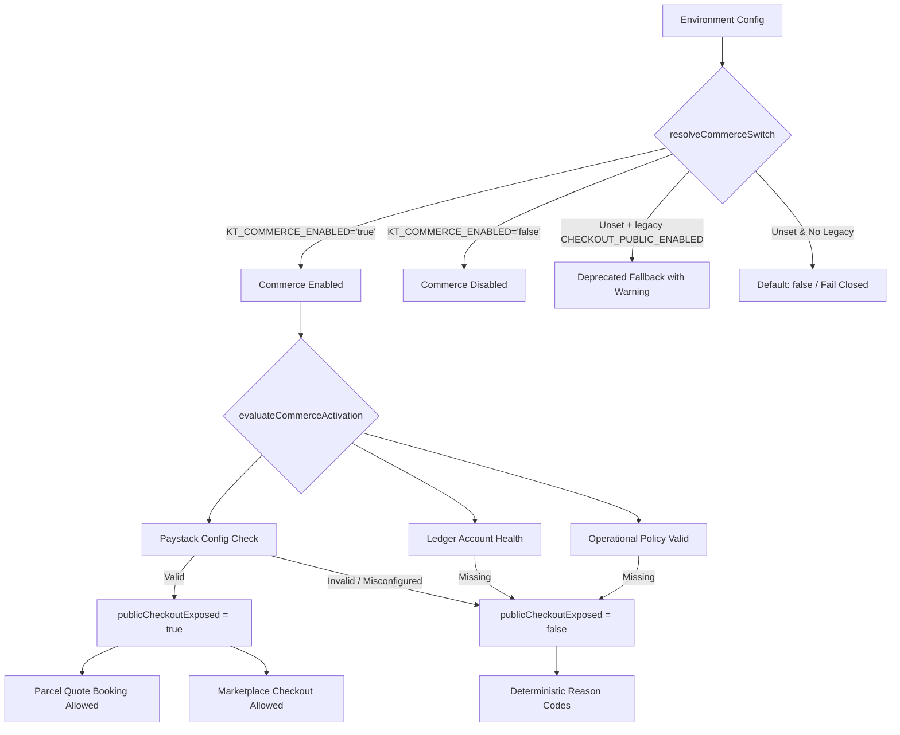
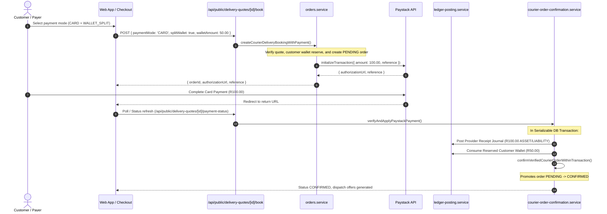
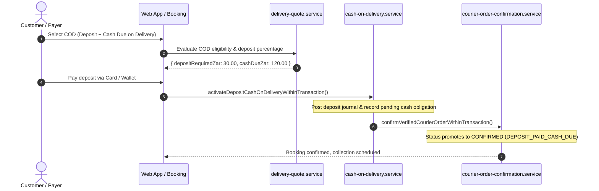
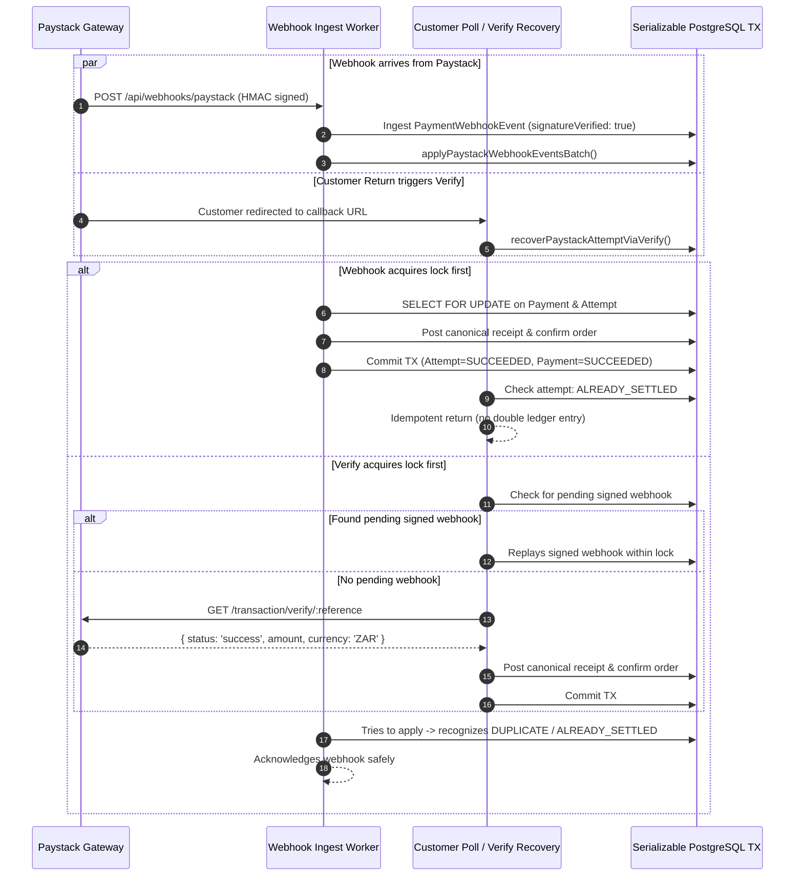
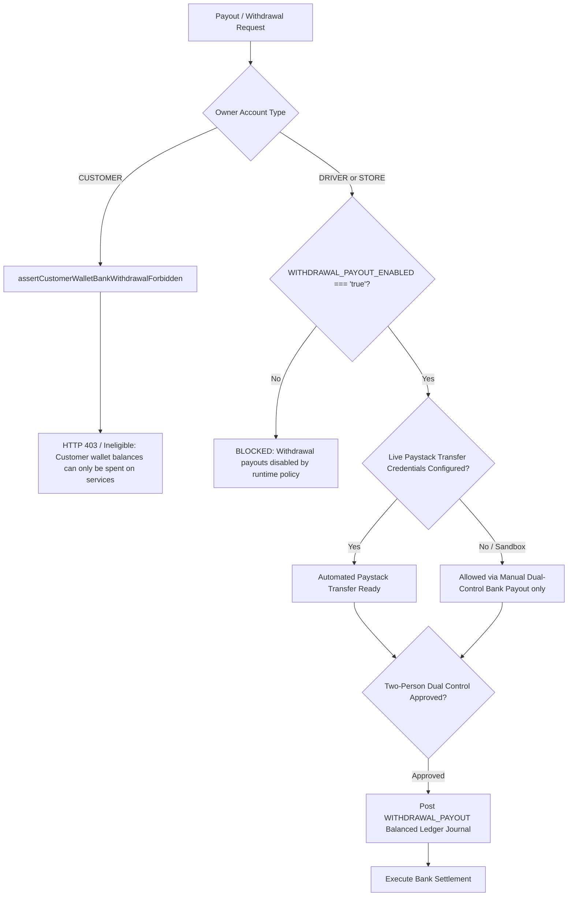

# KT Couriers — Commerce Activation Sequence Diagrams & Test Invocation Map
Issue Date: 21 November 2026
Baseline Commit: `f06493ffe37c97059eafb0bcc0e9665eec830095`
Authority: Final One-Pass Code-Level Completion Directive (§B.2)

---

## 1. Single Switch Architecture (`KT_COMMERCE_ENABLED`)



### Invariants:
- The switch **never** creates ledger journals, converts CASH to DIGITAL, authorizes withdrawals, or overrides risk policies.
- In-flight operations, refund processing, and liability reconciliations operate even when public commerce is off.

---

## 2. Parcel Delivery Booking & Payment Lifecycles

### 2.1 Digital Payment with Wallet Split Flow



### 2.2 Cash On Delivery (COD) with Partial Deposit



---

## 3. Webhook vs Verify API Race & Concurrency Resolution



---

## 4. 24-Hour Unpaid Order Expiry & Late Settlement Reconciliation

```mermaid
sequenceDiagram
    autonumber
    participant Loop as Processor Loop (expire-unpaid-courier-orders)
    participant DB as Database
    participant Provider as Paystack Gateway
    participant VerifySvc as paystack-verify-recovery.service
    participant Recon as payment-reconciliation.service

    Note over Loop: Order remains unpaid for 24 hours
    Loop->>DB: Find PENDING orders with createdAt < NOW - 24h
    Loop->>DB: transitionOrderStatusInTx(PENDING -> CANCELLED, '24h unpaid expiry')
    Loop->>DB: Cancel dispatch offers & uncollected COD obligations

    Note over Provider,VerifySvc: Customer delayed payment arrives AFTER cancellation
    Provider->>VerifySvc: Webhook or Verify reports success (R150.00 ZAR)
    VerifySvc->>DB: Begin Serializable TX (FOR UPDATE)
    VerifySvc->>DB: Post receipt journal (CASH_CLEARING -> CUSTOMER_FUNDS_HELD)
    Note over VerifySvc: Inspect Order status: CANCELLED
    Note over VerifySvc: NEVER promote CANCELLED -> CONFIRMED
    VerifySvc->>DB: revokePendingDispatchOffersInTx()
    VerifySvc->>DB: settlePaidOrderCancellationInTx()
    Note over VerifySvc: Initiates full wallet credit or payment refund for customer
    VerifySvc->>DB: upsertParcelCancellationResolutionInTx(COMPLETED_LATE_PAYMENT_REFUND_INITIATED)
    VerifySvc->>Recon: openPaymentReconciliationCaseWithinTransaction('OUT_OF_ORDER_EVENT')
    VerifySvc->>DB: Commit TX (Funds safe in ledger, order remains cancelled, refund queued)
```

---

## 5. COD Physical Delivery Exception & Balanced Shortage Accounting

```mermaid
sequenceDiagram
    autonumber
    actor Driver as Driver / Courier
    actor Admin as Finance Admin
    participant ExceptionSvc as cod-physical-delivery-exception.service
    participant Ledger as ledger-posting.service
    participant DB as Database

    Driver->>ExceptionSvc: Report parcel delivered with partial or zero cash collected
    ExceptionSvc->>DB: Record physical delivery exception (status: OUTSTANDING)
    Note over ExceptionSvc: Order is NOT marked PAID; no seller earnings or driver fee released

    Admin->>ExceptionSvc: Review exception (decision: VERIFY)
    Note over ExceptionSvc: Dual-control verification with cash shortage
    ExceptionSvc->>DB: ensureShortageReceivableAccounts(tx)
    ExceptionSvc->>Ledger: Post balanced shortage journal:
    Note over Ledger: DEBIT: PLATFORM-COD-UNCOLLECTED-RECEIVABLE-ZAR (ASSET)<br/>CREDIT: PLATFORM-COD-UNCOLLECTED-SHORTAGE-SUSPENSE-ZAR (LIABILITY)
    ExceptionSvc->>DB: Update exception: VERIFIED_CASH_OUTSTANDING
    Note over ExceptionSvc: No revenue recognized, no fake money minted

    Admin->>ExceptionSvc: Resolve shortage (RECOVERED with bank evidence, or WRITTEN_OFF)
    ExceptionSvc->>Ledger: Post balanced clearing journal:
    Note over Ledger: DEBIT: PLATFORM-COD-UNCOLLECTED-SHORTAGE-SUSPENSE-ZAR<br/>CREDIT: PLATFORM-COD-UNCOLLECTED-RECEIVABLE-ZAR (or Cash Clearing)
    ExceptionSvc->>DB: Mark exception RESOLVED
```

---

## 6. Earned Payouts vs Customer Wallet Bank Withdrawal Ban



---

## 7. Test Invocation Matrix

| Flow / Requirement | Primary Test Files | Execution Command | Invariant Asserted |
| :--- | :--- | :--- | :--- |
| **Commerce Activation Switch** (C01, C02) | `tests/runtime/commerce-activation.test.ts`, `tests/production-readiness/capability-matrix.test.ts` | `npx vitest run tests/runtime/commerce-activation.test.ts` | Single canonical switch, zero direct reads of deprecated flag, fail-closed default. |
| **Risk-Scoped Refunds** (C03) | `tests/refunds/refund-production-readiness.test.ts` | `npx vitest run tests/refunds/refund-production-readiness.test.ts` | Wallet refunds active even when commerce off; provider refunds require live credentials. |
| **Forbidden Customer Cash-Out** (C03) | `tests/withdrawals/withdrawal-production-readiness.test.ts` | `npx vitest run tests/withdrawals/withdrawal-production-readiness.test.ts` | `CUSTOMER_WALLET_BANK_WITHDRAWAL_ALLOWED` permanently false; throws `WITHDRAWAL_OWNER_INELIGIBLE`. |
| **Promotions Release Gate** (C04) | `tests/promotions/production-lock-negative.test.ts`, `tests/policy/promotion-production-readiness.test.ts` | `npx vitest run tests/promotions/production-lock-negative.test.ts` | Advertising and promoter locks remain false; commerce switch gates commercial promotions; cleanup allowed. |
| **Suburb vs Line2 Decoupling** (C05) | `tests/marketplace-checkout/store-pickup-selection.test.ts`, `tests/unit/store-courier-pickup-suburb.test.ts` | `npx vitest run tests/marketplace-checkout/store-pickup-selection.test.ts` | Units/flats on line2 not conflated as suburbs; legacy non-unit line2 suburbs preserved. |
| **Customer Address Retention** (C06) | `tests/marketplace-checkout/customer-checkout-prefill.test.ts`, `tests/marketplace-checkout/address-route.test.ts` | `npx vitest run tests/marketplace-checkout/customer-checkout-prefill.test.ts` | Saved coordinates preserved in trusted account context without silent blanking. |
| **COD Shortage Suspense Accounting** (C07) | `tests/orders/cod-physical-shortage-accounting.test.ts`, `tests/e2e/cod-physical-exception.spec.ts` | `npx vitest run tests/orders/cod-physical-shortage-accounting.test.ts` | Balanced ASSET receivable vs LIABILITY suspense entry; zero seller revenue or driver commission minted on cash loss. |
| **Processor Loop Concurrency** (C08) | `tests/processors/production-loop.test.ts`, `tests/processors/processor-registry-consistency.test.ts` | `npx vitest run tests/processors/production-loop.test.ts` | Multi-worker heartbeat aggregation without clobbering; cadence throttle only triggers on expired work. |
| **Paystack Verify & 24h Expiry Races** (C09) | `tests/payments/paystack-verify-recovery.test.ts`, `tests/payments/courier-verified-order-confirmation.test.ts` | `npx vitest run tests/payments/paystack-verify-recovery.test.ts` | Paid parcel confirms automatically; late payment on cancelled order reconciles via refund without reviving order; wallet split consumed. |
| **Store SQL Publication & Repair Cockpit** (C10) | `tests/storefront/sql-store-publication.test.ts`, `tests/admin/store-repair-cockpit.test.ts`, `tests/admin/store-checkout-blockers.test.ts` | `npx vitest run tests/admin/store-repair-cockpit.test.ts` | Distinguishes SQL enforcement from per-store records; actionable blockers and repair links exposed. |
| **Production Lock Register** (§B.1) | `tests/governance/production-lock-register.test.ts` | `npx vitest run tests/governance/production-lock-register.test.ts` | Complete register of all 10 release locks, scopes, defaults, and unblock criteria. |
| **Environment Redacted Schema** (§B.4) | `scripts/verify-env-schema.mjs` | `npm run env:verify` | Verifies presence of all required variables without echoing secret values. |
